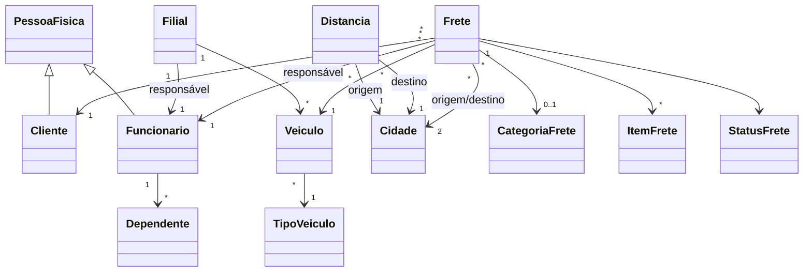

# 🚚 Sistema de Frete — Transportadora (JPA)

Camada de domínio e de persistência de uma transportadora, feita em **Java 17 + JPA/Hibernate + MySQL**.
O sistema registra fretes, calcula o valor de cada um a partir de distância, peso e categoria de entrega,
escolhe automaticamente o veículo adequado e controla o ciclo de vida do frete com regras de negócio.


---

## ✨ Funcionalidades

- **Registro de frete** com validações de cliente (ativo), cidades (origem ≠ destino), itens e funcionário responsável.
- **Seleção automática de veículo**: escolhe o menor veículo cuja capacidade suporta o peso total dos itens.
- **Cálculo do valor do frete** com `BigDecimal` e arredondamento `HALF_UP`.
- **Máquina de estados do frete** (`PENDENTE → EM_TRANSPORTE → ENTREGUE`, ou `CANCELADO`), sem retrocesso e sem alteração de frete cancelado.
- **Exceções de domínio** (`FreteException`) com mensagens claras para cada regra violada.
- **Suíte de testes de integração** (18 cenários) cobrindo caminho feliz, validações e regras de status.

## 🧮 Regra de cálculo

```
ValorFrete = (D × VKM + AD) × (1 + P_peso) × (1 + P_categoria)
```

| Símbolo | Significado | Valor |
|---|---|---|
| `D` | Distância em km entre origem e destino | cadastrada em `Distancia` |
| `VKM` | Valor por km rodado | R$ 2,00 |
| `AD` | Adicional fixo da rota | cadastrado em `Distancia` |
| `P_peso` | Acréscimo por faixa de peso | até 100 kg: 0% · 100–300 kg: 10% · acima de 300 kg: 20% |
| `P_categoria` | Acréscimo da categoria de entrega | Normal 0% · Rápida 10% · Super Rápida 30% |

**Exemplo:** São Luís → Fortaleza (800 km, AD = R$ 50), 150 kg, entrega Rápida
`(800 × 2,00 + 50) × 1,10 × 1,10 = R$ 1.996,50`

## 🗂️ Modelo de domínio



`PessoaFisica` usa herança `JOINED`, então `Cliente` e `Funcionario` ganham tabelas próprias ligadas à tabela base.

## 🏗️ Estrutura

```
src/main/java/com/transportadora
├── model/       # Entidades JPA e enums (Frete, Cliente, Veiculo, StatusFrete...)
├── dao/         # GenericDAO + DAOs específicos
├── service/     # FreteService (regras de negócio) e PopularBanco (carga de dados)
├── exception/   # FreteException
└── util/        # JPAUtil (EntityManagerFactory configurado via .env)
```

## 🚀 Como executar

### Pré-requisitos
- JDK 17+
- Maven 3.9+
- MySQL 8 rodando localmente

### 1. Configure as credenciais do banco

As credenciais **não ficam no código**. Copie o arquivo de exemplo e preencha com os dados do seu MySQL:

```bash
cp .env.example .env
```

```dotenv
DB_URL=jdbc:mysql://localhost:3306/db_frete_transportadora?createDatabaseIfNotExist=true
DB_USER=root
DB_PASSWORD=sua_senha_aqui
```

> O `.env` está no `.gitignore`. Variáveis de ambiente com os mesmos nomes têm prioridade sobre o arquivo,
> o que facilita rodar em CI ou em containers.

O banco `db_frete_transportadora` é criado automaticamente e as tabelas são geradas pelo Hibernate (`hbm2ddl.auto=update`).

### 2. Popule o banco com dados de exemplo

Execute a classe `com.transportadora.service.PopularBanco` pela IDE, ou:

```bash
mvn compile exec:java -Dexec.mainClass=com.transportadora.service.PopularBanco
```

### 3. Rode os testes

```bash
mvn test
```

## 🧪 Testes

`FreteServiceTeste` roda contra o banco real (testes de integração) e cobre:

| Grupo | Cenários |
|---|---|
| Registro de frete | sucesso, categoria rápida, sem cliente, cliente inativo, origem = destino, sem distância cadastrada, sem itens, nenhum veículo comporta o peso |
| Cálculo | faixas de peso (≤100, 100–300, >300 kg), categoria rápida, peso acima da capacidade do veículo |
| Status | PENDENTE → EM_TRANSPORTE → ENTREGUE, retrocesso bloqueado, frete cancelado imutável, EM_TRANSPORTE só a partir de PENDENTE |

## 🛠️ Tecnologias

- Java 17
- Jakarta Persistence 3.1 + Hibernate ORM 6.4
- MySQL Connector/J 8.3
- dotenv-java (carregamento das credenciais)
- JUnit 5

## 📄 Licença

Distribuído sob a licença MIT. Veja [LICENSE](LICENSE).
